# Over The Hill Plus

A pack of mods for **over the hill**. Bigger lobbies, a better server browser, chat, extra cameras, more graphics
settings, trailers, custom horns and 18 new cars to buy in the garage.

Install all of it or just the bits you want. Anything can be turned off in game.

## Install

### [Download OverTheHillMods-Installer.zip](https://github.com/legomaster188/OverTheHillPlus-QoL/releases/latest/download/OverTheHillMods-Installer.zip)

1. Close the game, unzip the download and double-click `Install.bat`.
2. It finds the game on its own (if it can't, paste in the game folder) and sets up BepInEx if you don't have it.
3. Pick `1` for everything or `2` to choose. `3` updates, `4` uninstalls.
4. Start the game. The first launch takes a few minutes. Press **F7** or go to Esc > **MODS**.

No admin rights needed. `Install.ps1` is plain text if you want to read what it does first. Cars get downloaded only if
you pick them, so the zip itself is tiny.

**By hand:** install [BepInEx 6 IL2CPP build 788](https://builds.bepinex.dev/projects/bepinex_be/788/BepInEx-Unity.IL2CPP-win-x64-6.0.0-be.788%2B5b766a3.zip)
(newer builds might not work), then unzip `OverTheHillMods-All.zip` from the
[latest release](https://github.com/legomaster188/OverTheHillPlus-QoL/releases/latest) into the game folder.

**Updating:** run the installer again and pick `3`, or use **AVAILABLE MODS** in game. Every mod list is signed; the installer and the game refuse one that isn't.

**Uninstalling:** pick `4`, or delete `BepInEx\plugins\OverTheHillMods\`. Settings live in `BepInEx\config\oth.*`.

## Mods

| | Mod | |
|---|---|---|
| 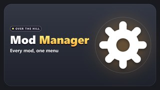 | **Mod Manager** | The MODS menu, installing and updating. Everything else needs it |
| 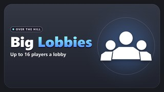 | Lobby+ | Up to 16 players instead of 4 |
| 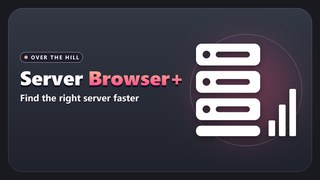 | Server Browser+ | Favourites, filters, all regions at once, friends' servers, rejoin |
| 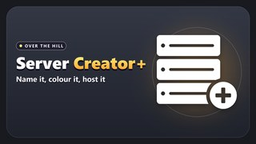 | Server Creator+ | Coloured server names and a join message |
| 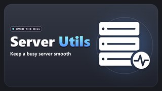 | Host+ | Ping list, kick/ban tools, autosave, share your settings with a code |
| 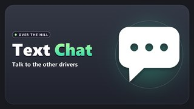 | Chat+ | Press T to chat |
| 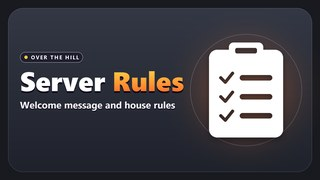 | Rules+ | Welcome message, rules and vote kick. Host only |
| 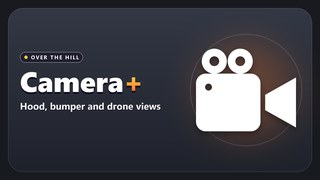 | Camera+ | Hood, bumper, far chase and drone cams |
| 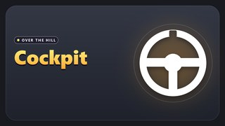 | Cockpit+ | First person with a dash and wheel for every car |
| 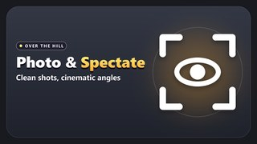 | Photo+ | Big screenshots, hide the HUD, watch other players |
| 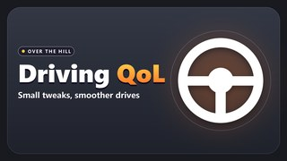 | Driving+ | FPS cap, FOV, auto headlights, skip intros, unstuck button |
| 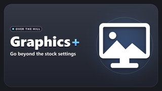 | Graphics+ | A lot more graphics settings, plus presets |
| 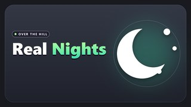 | Nights+ | Actually dark nights. Your headlights matter now |
| 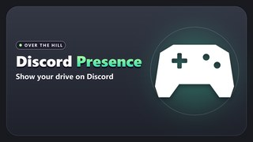 | Discord+ | Shows your map and car on Discord |
| 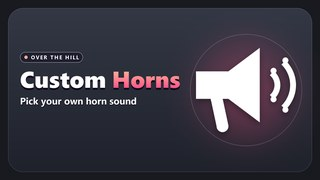 | Horns+ | Pick a horn or use your own .wav |
| 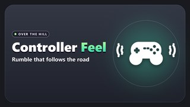 | Rumble+ | Rumble for gravel, bumps, landings and wheelspin |
| 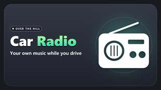 | Radio+ | Play your own music while you drive |
| 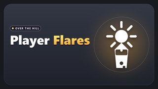 | Flares+ | See friends' names from far off and shoot a flare |
| 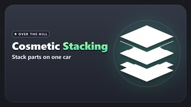 | Stacking+ | Shift + click to put more than one cosmetic in a slot |
| 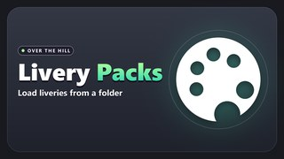 | Liveries+ | Load liveries from a folder instead of mod.io |
| 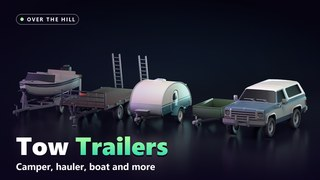 | Trailers+ | Tow a trailer, camper, car hauler or boat |
| 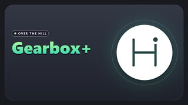 | Gearbox+ | More gears or the real car's gearbox, a real neutral, and diff locks (K) |

## Cars

Bought in the garage like any other car, with their own paints and liveries, and they take the game's cosmetics.

| | Car | |
|---|---|---|
| 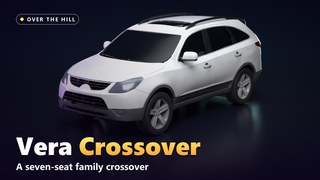 | Vera | Seven-seat crossover |
| 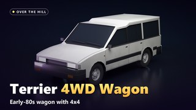 | Terrier | Little 80s 4WD wagon |
| 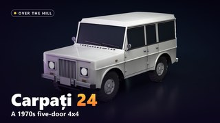 | Carpați 24 | 70s Romanian-style 4x4, slow and tough |
| 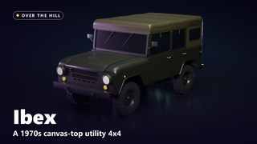 | Ibex | 70s soft-top utility 4x4 |
| 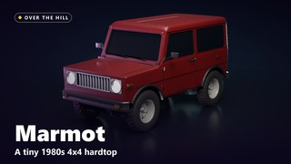 | Marmot | Tiny 80s 4x4 |
| 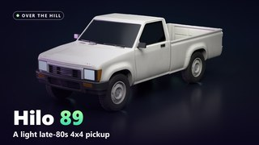 | Hilo 89 | Late 80s compact pickup |
| 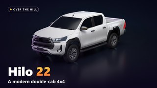 | Hilo 22 | Modern double-cab diesel pickup |
| 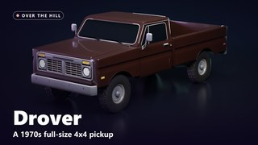 | Drover | 70s full-size long bed pickup |
| 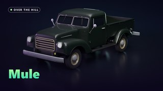 | Mule | Late 40s stepside pickup |
| 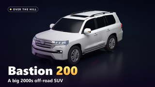 | Bastion 200 | Big 2000s SUV |
| 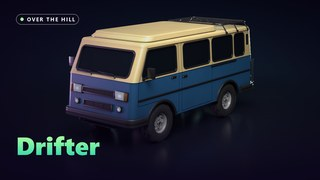 | Drifter | 80s 4x4 camper van with a pop-top |
| 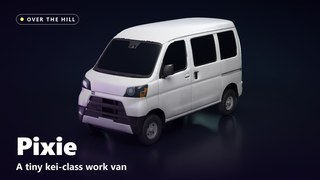 | Pixie | Kei van |
| 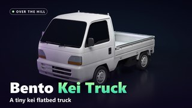 | Bento | Kei flatbed truck |
| 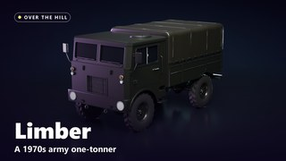 | Limber | 70s army one-tonner |
| 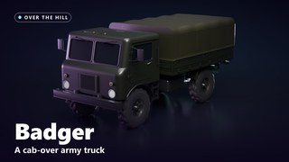 | Badger | Cab-over army truck |
| 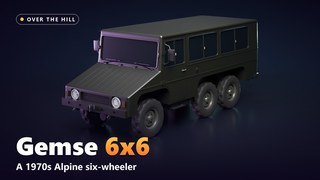 | Gemse 6x6 | Six-wheel Alpine crawler |
| 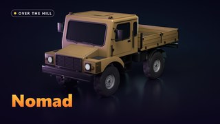 | Nomad | Huge expedition truck on portal axles |
| 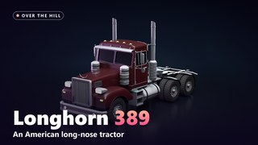 | Longhorn 389 | American semi |

### Liveries on the new cars

Every car except the Drifter comes with three liveries in the garage's Liveries tab, plus "Paint" for your own colours.
They're free and not locked behind kilometres. Some of them are see-through in places, so they sit on top of whatever
paint you picked. Other players with the car mod see your livery too.

Making your own works like a normal livery mod:

1. Grab the car's template from [`liveries/templates`](liveries/templates) (the README there walks you through it). It's
   the car's 2048 x 2048 texture with big labels, arrows, and colours for the paint, glass and lamps. The `_guides`
   version is just the lines, for laying over your work, and the `_base` version is the car's normal paint.
2. Paint a 2048 PNG on it. Leave parts transparent if you want the player's paint to show through there.
3. Put it in a folder with a `manifest.json`:

   ```json
   {"liveries": [{"car": "Hilo", "name": "My Livery", "texture": "my_livery.png", "icon": "my_livery_icon.png"}]}
   ```

   `car` is the car's name in the game: `Vera`, `Terrier`, `Carpati`, `Ibex`, `Marmot`, `Hilo`, `Hilo22`, `Drover`,
   `Mule`, `Bastion`, `Pixie`, `Bento`, `Limber`, `Badger`, `Gemse`, `Nomad` or `Longhorn`.
4. To try it, drop the folder in `Documents\My Games\over the hill\LocalLiveries\` and pick it in the garage's Livery
   Mods tab (turn on "Show local mods"). It also shows on the car's page in MODS, under Skin.

You can upload it to mod.io like any livery. mod.io has no tag for these cars, so tick no car tag and put the car's name
in the title or description so people can find it. Other players only see a mod.io livery if they're subscribed to it
too.

With Liveries+ you can also keep livery packs in `BepInEx\config\oth.liveries\` and skip mod.io entirely.

Everyone in the lobby needs the same car mods (and Trailers+) as the host. If you get "banned from this session" when
joining, that's why. Option `1` in the installer gets you everything.

## Problems

- **Installer can't find the game:** Steam > right click the game > Manage > Browse local files, and paste that path in.
- **No MODS menu:** wait for the main menu on the first launch, it's slow. Still nothing? Check
  `BepInEx\LogOutput.log` for red lines.
- **Broke after a game update:** run the installer and pick `3`. If there's no update yet, give it a bit.
- **Antivirus ate a file:** the DLLs aren't signed. Add the game folder as an exception and reinstall.

When reporting a bug, attach `BepInEx\LogOutput.log` and the newest file from `BepInEx\oth-debug\` (and
`BepInEx\oth-reports\` if it crashed). Please report here, not to the game devs.

## Building

You need the .NET 6 SDK or newer, and the game with BepInEx run at least once.

```
dotnet build src/OverTheHillMods.sln -c Release -p:GameDir="C:\path\to\over the hill"
```

That copies the DLLs into the game. Add `-p:NoDeploy=true` if the game is open.

Want to make your own mod that shows up in the MODS menu? See [docs/modding-api.md](docs/modding-api.md) and
`examples/HelloMod`.

## Credits

Six of the cars started from models on Sketchfab, all under [CC BY 4.0](http://creativecommons.org/licenses/by/4.0/).
I stripped the interiors, badges and plates, fixed them up and retextured them to fit the game.

- Vera: ["Hyundai ix55- Veracruz 2011"](https://sketchfab.com/iori308408) by Nieve5677
- Hilo 89: ["Toyota Hilux 1989"](https://sketchfab.com/3d-models/toyota-hilux-1989-5f545f0a2fdc4acd8d551e773fa24a1c) by [Plevako](https://sketchfab.com/Plevako)
- Hilo 22: ["2022 Toyota Hilux"](https://sketchfab.com/3d-models/2022-toyota-hilux-82bd37c5065040098fb0b86e07fcb959) by [BHP3D](https://sketchfab.com/BHP3D)
- Bastion 200: ["Toyota Land Cruiser J200 2017"](https://sketchfab.com/3d-models/toyota-land-cruiser-j200-2017-374e85a6e18743429f6d9c0e7bbffb3c) by [David_Holiday](https://sketchfab.com/David_Holiday)
- Pixie: ["Daihatsu Hijet"](https://sketchfab.com/3d-models/daihatsu-hijet-13c80ca6d94e4600b0440c59281367f5) by [Jazmin_BeamNG_Lover](https://sketchfab.com/aacps)
- Bento: ["Honda Acty"](https://sketchfab.com/3d-models/honda-acty-20bd497876a44910bff0670d86127a9b) by [Car2022](https://sketchfab.com/Car2022)

The rest of the cars are built from scratch.

Fan made. Not affiliated with Funselektor.
